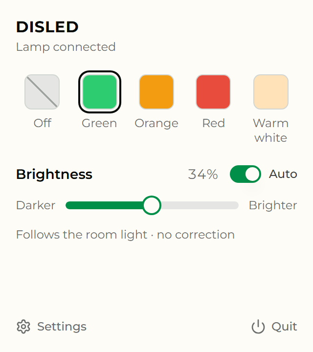
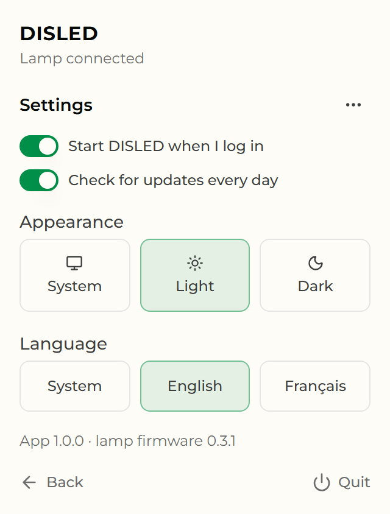
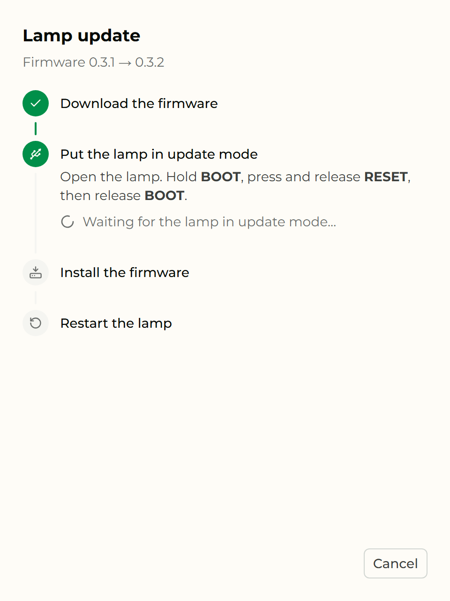
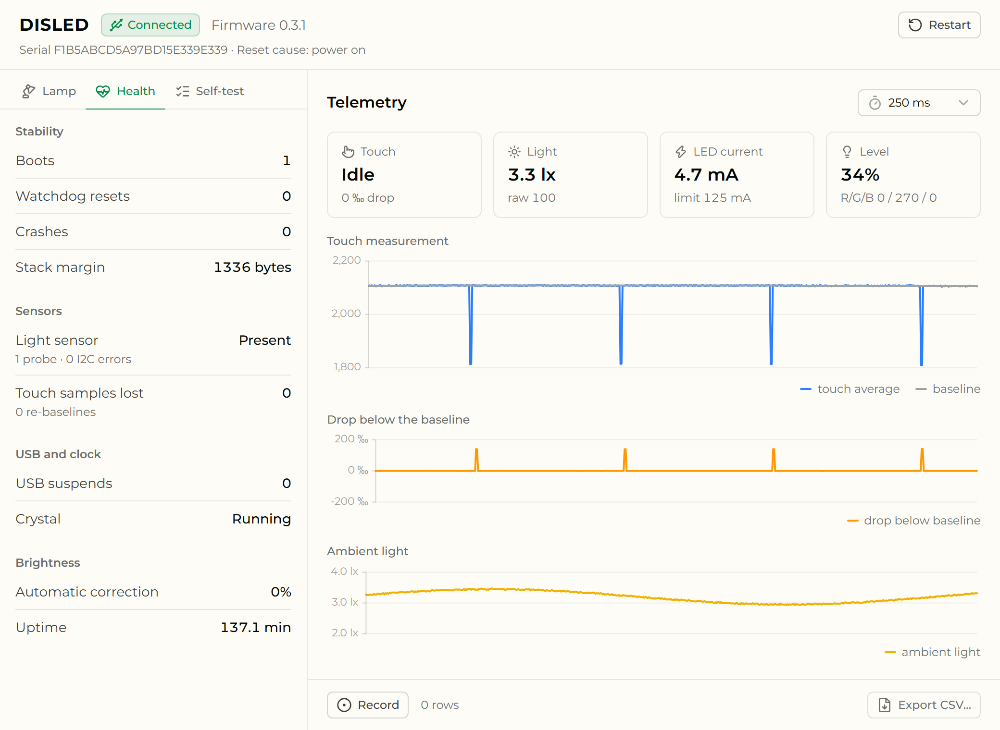

# DISLED user guide

DISLED is a 4 cm cube that glows to tell the people around you whether you
can be disturbed. This guide covers everyday use: the lamp, its desktop app,
the updates, and what to do when something goes wrong.

- [The lamp](#the-lamp)
- [Install the app](#install-the-app)
- [The tray icon](#the-tray-icon)
- [The popup](#the-popup)
- [Updates](#updates)
- [Diagnostics](#diagnostics)
- [Troubleshooting](#troubleshooting)
- [Get help](#get-help)

## The lamp

Plug the lamp into your computer with a USB-C cable that carries data. A
charge-only cable lights the lamp, but the app cannot see it. The lamp
starts green, with its brightness following the room light.

**Colors.** Green, orange and red come from the touch, warm white from the
app. What they mean is up to you and your team. The usual reading is green
for available, orange for busy and red for do not disturb. Warm white makes
the cube a small light.

**Touch.** The top of the cube is the touch surface:

| Gesture | Lamp on | Lamp off |
|---|---|---|
| Short touch | Next color, in the order green, orange, red, then green again (warm white goes to green) | Nothing |
| Hold for 2 s | Turns off, while your finger is still down | Turns on, in its last color |

An object laid on the top acts as one long touch, so the lamp turns off or
on after 2 s, then ignores the object. Take it away and the touch works
again.

**Brightness.** The lamp reads the room light through a small window on
the left side of its base, and dims or brightens within a second or two
when the room changes. In the dark it keeps a faint glow. Leave the window
uncovered.

**Without the app.** The lamp works the same, with the touch and the
automatic brightness. On a phone charger, or on a hub with no computer, it
limits its power and is a little less bright at the top of its range.

**Sleep.** When the computer sleeps, the lamp turns off. It comes back when
the computer wakes up.

At every power-up the lamp starts green, in automatic brightness. The app
then applies your brightness settings again ([Settings](#settings)).

## Install the app

Download the installer of your system from the
[latest release](https://github.com/Oui-Dev/DISLED/releases/latest):

| System | File |
|---|---|
| Windows 10 and 11 | `DISLED_X.Y.Z_x64-setup.exe` |
| macOS on Apple Silicon | `DISLED_X.Y.Z_aarch64.dmg` |
| Debian, Ubuntu and derivatives | `DISLED_X.Y.Z_amd64.deb` |

The installers carry no publisher certificate, so Windows and macOS warn
once:

- **Windows.** SmartScreen shows "Windows protected your PC". Click **More
  info**, then **Run anyway**.
- **macOS.** Drag DISLED into Applications and open it. macOS refuses the
  first time: open System Settings, Privacy & Security, click **Open
  Anyway** next to the message about DISLED, and confirm with your
  password.
- **Linux.** The package also installs a rule that lets you open the lamp
  without root rights. It applies at once, without unplugging the lamp.

From then on the app starts with your session, unless you turn that setting
off. It lives in the notification area on Windows, the menu bar on macOS
and the tray on Linux. Only one copy runs, and starting it again opens the
popup. The app updates itself ([Updates](#updates)).

## The tray icon

The icon is a rounded square in the color of the lamp, an outline when the
lamp is off, and a faint outline when no lamp is connected.

- **Left click** opens or closes the popup.
- **Right click** opens a menu with **Open DISLED**, **Diagnostics…** and
  **Quit DISLED**. On Linux the menu is the only way in, because the tray
  gives no clicks to the app.

On Windows the icon may land in the hidden icons, behind the **^** arrow of
the taskbar. Drag it onto the taskbar to keep it in view.

## The popup

<picture>
  <source media="(prefers-color-scheme: dark)" srcset="images/user-guide/popup-lamp-dark.png">
  
</picture>

- **Status.** "Lamp connected", "Connecting…" or "No lamp connected".
- **Colors.** **Off** and the four colors. The one in use has an outline.
- **Brightness.**
  - With **Auto** on, the lamp follows the room light, and the percentage
    next to the switch is the level it uses now. The slider shifts the
    automatic brightness, from **Darker** to **Brighter** (−50 to +50 %).
  - With **Auto** off, the slider sets a fixed level, from 1 to 100 %.
- **Settings** opens the settings page, **Quit** closes the app. When an
  update is on offer, **Settings** turns green, with a dot.

Without a lamp, the popup still takes your settings, and they apply when you
plug the lamp in. The popup hides when you click elsewhere or press Escape.

### Settings

<picture>
  <source media="(prefers-color-scheme: dark)" srcset="images/user-guide/popup-settings-dark.png">
  
</picture>

- **Start DISLED when I log in**, **Check for updates every day**.
- **Appearance.** System, Light or Dark.
- **Language.** System, English or Français.
- The versions of the app and of the lamp firmware, to give when you
  report a problem.
- The **⋯** button (More actions): **Check for updates**, **Open
  diagnostics…**, **Reinstall the lamp firmware…**, and when the app last
  checked for updates.

The app keeps your settings on this computer: brightness mode, fixed level,
correction, and the settings above. It sends the brightness ones to the
lamp every time the lamp connects. The app does not save the color and
on/off, so the lamp always starts green.

## Updates

### The app

The app looks for a new version when it starts, then once a day unless you
turn that off. When there is one, **Settings** turns green at the bottom of
the popup, and the settings page says "DISLED X.Y.Z is available." with
**Install and restart**. The app then downloads the update, installs it and
starts again by itself, its popup open. Updates are signed, so the app
installs only versions published by the DISLED project.

### The lamp

The app also looks for a newer lamp firmware. When there is one,
**Settings** turns green too, and the settings page says "Lamp firmware
X.Y.Z is available." with **Update the lamp…**. If the app has an update
too, the settings page shows both: install the app first, because a new
firmware may need a new app. **Update the lamp…** comes once the app is up
to date.

<picture>
  <source media="(prefers-color-scheme: dark)" srcset="images/user-guide/lamp-update-dark.png">
  
</picture>

A window guides the update. It takes about a minute, and you will open the
lamp, because its update mode starts with two buttons on its board,
**BOOT** and **RESET**. Keep the lamp plugged in all along.

1. **Download the firmware.** The app downloads it and checks its
   signature.
2. **Put the lamp in update mode.** Open the lamp: pinch the cube at its
   grip stripes, over the clips, and lift it off its base. The touch ring
   inside the cube stays wired to the board, so lift gently. Hold
   **BOOT**, press and release **RESET**, then release **BOOT**.

   The first time on Windows, the window then asks for a driver for the
   update mode, once per computer. Download [Zadig](https://zadig.akeo.ie/)
   and run it. In **Options**, choose **List All Devices**, select the
   device whose USB ID is `4348 55E0` or `1A86 55E0`, choose **WinUSB**,
   then **Install Driver** or **Replace Driver**. The update goes on by
   itself once the driver is in place.
3. **Install the firmware.** Do not unplug the lamp.
4. **Restart the lamp.** The app checks the version the lamp reports. Put
   the cube back on its base.

If the update stops, click **Try again**. The lamp is not damaged: its
update mode always works, whatever happened before. A lamp that no longer
starts gets its firmware the same way, from **⋯**, **Reinstall the lamp
firmware…**, with or without a lamp connected.

## Diagnostics

<picture>
  <source media="(prefers-color-scheme: dark)" srcset="images/user-guide/diagnostics-dark.png">
  
</picture>

The Diagnostics window opens from the tray menu or from **⋯**, **Open
diagnostics…**. You will not need it every day. It shows what the lamp
sees, and helps to report a problem.

- **Top.** The connection, the firmware version, the serial number and why
  the lamp last restarted. **Restart** restarts the lamp, which comes back
  green in a few seconds.
- **Lamp.** The controls of the popup.
- **Health.** The lamp's counters: restarts, crashes, light sensor, touch,
  USB sleeps. A badge on the tab shows when something needs a look.
- **Self-test.** The lamp shows red, green, blue and warm white, which you
  check, then glows blue. Touch the top within 10 s.
- **Telemetry.** Touch, light, LED current and level, live. **Record**,
  then **Export CSV…**, saves the measurements to a file. The recording
  stays in the memory of the window until you export it, so closing the
  window, turning off the computer or a power cut loses it.

## Troubleshooting

| Symptom | What to do |
|---|---|
| "No lamp connected" | Use a cable that carries data, and plug the lamp into the computer or a powered hub. Right after the app starts, finding the lamp can take up to a minute on a computer with a USB device that answers slowly, such as some gaming mice. |
| The tray icon is missing (Windows) | Look behind the **^** arrow of the taskbar, then drag the icon onto the taskbar. |
| The lamp turns off by itself | An object laid on the top turns it off after 2 s. |
| Too bright or too dim in automatic mode | Move the slider toward **Brighter** or **Darker**, or turn **Auto** off for a fixed level. |
| The lamp turns off when the computer sleeps | This is expected. It comes back when the computer wakes up. |
| The lamp is dimmer on a phone charger | This is expected. Without a computer, it limits its power. |
| Lamp update: "Waiting for the lamp in update mode…" never ends | Check the button order (hold **BOOT**, press and release **RESET**, release **BOOT**), the driver on Windows, a cable that carries data, and that no other device is in update mode. |
| Lamp update: "The update stopped" | Click **Try again**. To flash by hand, see the [flashing guide](flashing.md). |
| The lamp stays dark after an update | Press **RESET**, or unplug the lamp and plug it back in. |

## Get help

Open an [issue](https://github.com/Oui-Dev/DISLED/issues) with:

- the app and lamp firmware versions, from the settings page of the popup;
- your system (Windows, macOS or Linux) and its version;
- what you did, what happened, and what you expected;
- for a touch or light problem, a recording: in Diagnostics, **Record**,
  reproduce the problem, then **Export CSV…** and attach the file.
